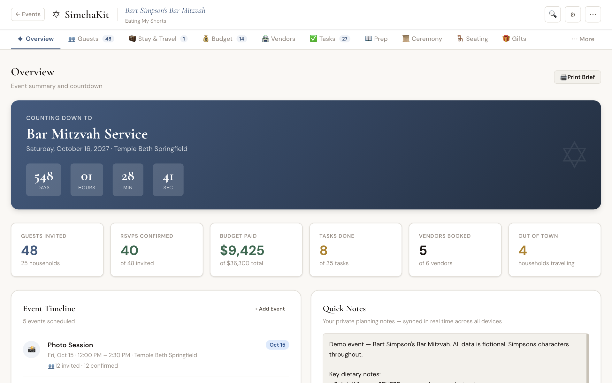
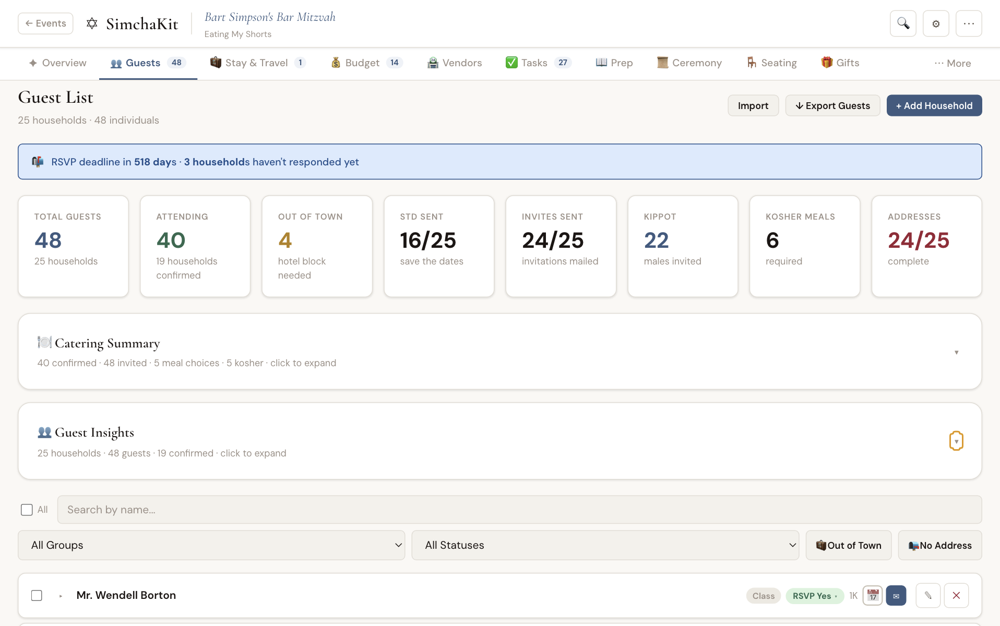
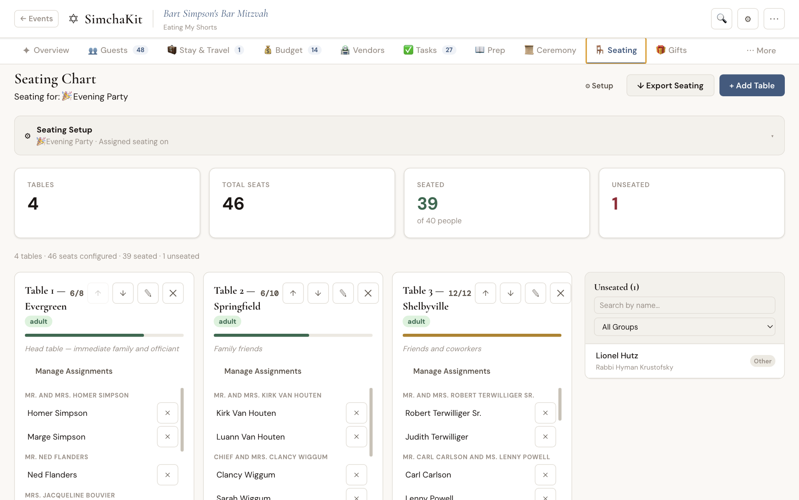
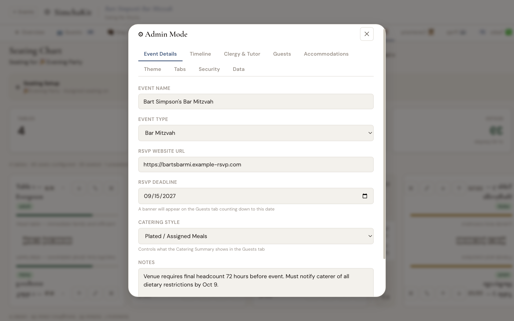

# SimchaKit

A real-time event planning web app for celebrations — B'nei Mitzvot, weddings, and other simchas.


## Hosted Version

> **Looking for something more?** The hosted version of SimchaKit is always running the latest features and accessible from anywhere -- no server required. Visit [app.simcha-kit.com](https://app.simcha-kit.com) to learn more.

## Screenshots

### Overview Dashboard


### Guest Management


### Seating Chart


### Admin Configuration


## Features

- **Shared Access** — invite co-planners as Editors (full access) or Viewers (read-only), or a Ritual Coordinator (ceremony and prep only) for clergy or tutors; collaborators covered by the event owner's purchase
- **Event Switcher**: on desktop, click the event name in the sidebar to switch between your events, including events shared with you, in one click; All events still opens the full picker (V3 only)
- **Guest Management** — households, people, formal names, dietary requirements, RSVP tracking; guest counts use one vocabulary on every screen (Total Guests, Confirmed, Awaiting, Expected), with tap-to-open explanations of how each number is counted
- **Sub-Event Support** — track attendance across multiple events (service, kiddush, reception); optional per-sub-event RSVP status with row-level chips and dedicated filtering on the Guests tab, a per-sub-event "invite all by default" setting in Admin Mode for events where only a handful of households attend a given sub-event, and a real per-person Yes/No/TBD attendance status for each sub-event a household is invited to; sub-events can also be flagged "meal served" so the Catering Summary produces a separate confirmed/kosher/meal-choice breakout per catering moment; confirmed and invited counts for each sub-event are also shown split into adults and kids, and guests who still owe an answer for a sub-event are counted, named in a one-click list, and printed in the brief (V3 only)
- **Budget Tracking** — expenses, payments, vendor costs, gratuity calculator; optional partial/installment payment schedules per expense (V3 only)
- **Vendor Management** — contacts, contracts, payment schedules
- **Task Lists** — categorized to-dos with due dates and completion tracking
- **Seating Charts** — table management with drag-and-drop assignment
- **Gift Tracking** — record gifts and track thank-you notes, including gifts given by more than one household (e.g. several families pooling on one gift), each giver tracked and thanked separately, and a giver who sends more than one gift can list them all in one record with a single thank-you (V3 only)
- **Favor Management** — track sweatshirts, kippot, or other party favors by size
- **Day-Of Mode** — streamlined mobile view for event day with hot sheet and vendor contacts; within 7 days of the event, a dismissible reminder banner surfaces it automatically on mobile (V3 only)
- **Real-Time Sync** — WebSocket-based updates across all connected devices (V2) / fetch-on-navigate (V3)
- **Theming** — customizable color palettes and event branding, including an optional event logo shown in the sidebar, the Overview countdown, and the printed guest list (owner/editor only, V3 only)
- **Print Brief** — generate a comprehensive event summary document; on phones and tablets, every printout and the brief opens the device's own print sheet in one tap, where you can print, share, or save as PDF (V3 only)
- **CSV Import/Export** — import guest lists, export for invitation vendors
- **Admin Mode** — sidebar navigation groups settings into Event Setup, People & Logistics, and App Config; owner-only access; changes save immediately
- **Backup & Restore** — export a full JSON backup and restore from any previous backup via Admin Mode → Data

## Tech Stack

### V3 — SimchaKit Platform (SaaS, hosted at app.simcha-kit.com)

- **Frontend**: Vite + React 18
- **Auth**: Supabase magic link (passwordless email)
- **Database**: Supabase (Postgres + Row Level Security)
- **Hosting**: Vercel (frontend + serverless API functions)
- **Payments**: Stripe (one-time fee per event)
- **Styling**: Custom CSS with CSS variables for theming

### V2 — Self-Hosted NAS Edition

- **Frontend**: Vite + React 18
- **Backend**: Node.js + Express + WebSocket
- **Data**: JSON file storage (per-event)
- **Styling**: Custom CSS with CSS variables for theming

## Quick Start

### V3 — SimchaKit Platform

Visit [app.simcha-kit.com](https://app.simcha-kit.com), sign in with your email, and create your first event. Learn more at [about.simcha-kit.com](https://about.simcha-kit.com).

### V2 — Self-Hosted

#### Prerequisites

- Node.js v18, v20, or v22
- npm v8+

#### Installation

```bash
# Clone the repository
git clone https://github.com/rebrook/simchakit.git
cd simchakit

# Install server dependencies
npm install

# Install client dependencies
cd client
npm install

# Build the client
npm run build
cd ..

# Start the server
node server.js
```

The app will be available at `http://localhost:3000/simcha/`

#### Creating Your First Event

1. Navigate to `http://localhost:3000/simcha/` — this opens the Event Picker
2. Click the **+ New Event** button
3. Enter an Event ID (e.g., `smith-wedding-2026`) — lowercase letters, numbers, and hyphens only
4. Click **Create**

You'll be taken to your new event dashboard. From there, open the **Admin** panel to configure:
- Event name and type (Bat Mitzvah, Wedding, etc.)
- Theme and color palette
- Timeline with sub-events (service, reception, etc.)
- Clergy and venue contacts

## Documentation

- **[DEPLOY.md](DEPLOY.md)** — Technical deployment reference
- **[HOW_TO_DEPLOY.md](HOW_TO_DEPLOY.md)** — Plain-English step-by-step guide

## Project Structure

```
simchakit/
├── client/                  # Vite + React frontend (shared build tooling)
│   ├── public/              # Static assets (favicon, changelog.json)
│   ├── index.html           # V2 Vite HTML entry
│   ├── index.v3.html        # V3 Vite HTML entry
│   ├── vite.config.js       # V2 build config (base: /simcha/, src/ alias)
│   ├── vite.config.v3.js    # V3 build config (base: /, src-v3/ alias)
│   ├── migrations/          # SQL migrations, one file per milestone (run in Supabase SQL editor)
│   ├── api/                 # Vercel serverless functions (V3 only)
│   │   ├── invites.js        # router: accept-invite, send-invite
│   │   ├── billing.js        # router: create-checkout-session, validate-coupon
│   │   ├── calendar.js       # router: generate-token, subscribe
│   │   ├── admin.js          # router: admin-query, reset-demo
│   │   ├── system.js         # router: notify, brevo-sync
│   │   ├── guest.js          # router (V5): send, test, unsubscribe, rsvp-token (owner/editor)
│   │   ├── rsvp.js           # router (V5): guest RSVP site, GET household view and POST reply (private token in X-RSVP-Token)
│   │   ├── stripe-webhook.js # kept separate (raw body + signature)
│   │   ├── cron/lifecycle-emails.js
│   │   └── _lib/             # the real handler code and shared helpers (not deployed as functions); email-shell.js is the shared guest-email layout
│   ├── src/                 # V2 source — never modified for V3 work
│   │   ├── components/      # Tab and modal components
│   │   ├── constants/       # Shared constants
│   │   ├── hooks/           # Custom React hooks
│   │   └── utils/           # Utility functions
│   └── src-v3/              # V3 source — never modified for V2 work
│       ├── App.v3.jsx       # V3 auth-aware root
│       ├── App.css          # Stylesheet entry: imports styles/ in cascade order (do not reorder)
│       ├── styles/          # base, shell, components, tabs, print (+ parts in subfolders)
│       ├── main.v3.jsx      # V3 React entry point
│       ├── components/      # V3 components (shell, tabs, events, auth)
│       │   ├── admin/       # Admin Mode sections (one file per section; AdminPanel.jsx keeps shell, nav, shared state)
│       │   ├── guests/      # Guests tab pieces (HouseholdModal, ImportModal, GuestExportModal, TimelineEntryModal, GuestInsights, GuestFilters, AwaitingPanel, MobileFilterSheet; V5 messaging: MessageComposer, SentLog, SentChip, MailingsPanel, UndoToast)
│       │   ├── dayof/       # Mobile Day-of view (DayOfOverlay.jsx keeps the desktop overlay)
│       │   └── shell/       # App shell pieces (AppShell.jsx keeps state and routing; Sidebar, MobileHeader, TopBar, BottomNav, MoreDrawer, AppFooter, ShellBanners, shellConfig/shellDates; avatar color/initials live in utils/avatar.js)
│       ├── constants/       # V3 constants
│       ├── hooks/           # V3 hooks (useEventData, useDarkMode)
│       ├── lib/             # Supabase client
│       └── utils/           # V3 utilities (incl. dayofBrief.js print brief, dayofTime.js)
├── src/                     # V2 Express server modules
│   ├── router.js            # API routes
│   ├── state.js             # State management
│   └── ws.js                # WebSocket handler
├── public/                  # V2 served files: Event Picker + per-event folders
│   ├── index.html           # V2 Event Picker
│   ├── favicon.svg          # Favicon
│   ├── assets/              # Built JS/CSS bundles (shared)
│   └── {event-id}/          # Per-event folders
│       └── index.html       # V2 event dashboard entry point
├── server.js                # V2 Express entry point
├── deploy.sh                # V2 build and deploy script
├── vercel.json              # V3 Vercel build + API routing config
└── changelog.json           # Version history (V2.x and V3.x)
```

## Deployment

### V3 — Vercel + Supabase

#### Application (Vercel)

Push to the `main` branch. Vercel automatically builds and deploys from `client/` using `vite.config.v3.js`. Serverless functions in `client/api/` are deployed alongside the frontend.

**Do not add files under `api/` without checking the 12-function limit; add an action to a router instead.** Vercel's Hobby plan allows 12 serverless functions per deployment. Old URLs such as `/api/accept-invite` are rewritten to a router (`/api/invites?action=accept-invite`) in `vercel.json` and `vercel.admin.json`; keep those rewrites above the `/api/:path*` catch-all. `node scripts/check-endpoints.mjs <old-url> <new-url>` compares two deployments.

Files that require a deploy when changed:
- Any file under `client/src-v3/`
- Any file under `client/api/`
- `client/public/changelog.json`
- `vercel.json`

#### Database (Supabase)

Schema changes (new tables, RLS policies, functions) are applied directly in the Supabase SQL editor. There is no ORM or migration runner -- SQL is written, reviewed, and pasted into the editor manually.

**Standard process for a database change:**
1. Write and review the SQL locally (in outputs)
2. Open the Supabase dashboard → SQL Editor
3. Paste the full migration block and run it
4. Run smoke test queries to verify the change took effect
5. No Vercel deploy is needed for database-only changes

**Migrations** live in `client/migrations/` (for example `V5.0-M1.sql`, guest messaging tables). Each file is idempotent and starts with a note on its RLS impact.

**Guest messaging (V5):** run `V5.0-M1.sql`, then `V5.0-M2.sql` (adds `message_log.channel` for paper and other-platform mailings and makes `message_recipients.email` optional). Run M2 before deploying the Guests tab changes, or the message history cannot load and rows fall back to the pre-V5 sent flags. Guests are emailed through `POST /api/guest?action=send` (use `dry_run` to preview and `action=test` to send a sample to yourself).

**Guest RSVP pages (V5):** `src-v3/rsvp/` (route `/r/:token`, rendered by `App.v3.jsx` above every auth hook, loaded as its own chunk). `vercel.json` adds `X-Robots-Tag: noindex`, `Referrer-Policy: no-referrer` and `Cache-Control: no-store` for `/r/*`. The guest page talks only to `/api/rsvp`, never to Supabase.

**RSVP review queue (V5):** run `V5.1-R3.sql` (after R1). It adds `applied_snapshot`, `reviewed_by`, `reviewed_at` and `reject_reason` to `rsvp_replies` and adds the table to the realtime publication. The queue lives in the Guests tab (`components/guests/ReplyQueue.jsx`; what an accept writes is in `utils/rsvpApply.js`, with its undo snapshot).

**RSVP site (V5):** run `V5.1-R1.sql` (after M1 and M2). It adds `household_rsvp_tokens`, `rsvp_replies` and `events.rsvp_settings`, with no access for anon. Guests call `GET/POST /api/rsvp` with their private token in the `X-RSVP-Token` header, never in a URL. No new environment variables.

**Guest messaging environment variables (Vercel):** `GUEST_MAIL_FROM` (a sender address verified in Brevo) and `GUEST_UNSUBSCRIBE_SECRET` (random string used to sign unsubscribe links), in addition to `BREVO_API_KEY`.

**Critical rules:**
- Any function referenced inside an RLS policy must have `EXECUTE` granted to `anon` -- even if anon never calls it directly. Failure surfaces as a table access error, not a function error.
- `CREATE OR REPLACE FUNCTION` does not preserve existing grants. Always re-run `GRANT EXECUTE` after replacing a function.
- The demo event (UUID `440a8b9e-e92e-4ad6-b352-41965bd8383b`) has hardcoded `anon` policies on every collection table. New tables must include matching Demo read and Demo write policies if they need to be accessible from `demo.simcha-kit.com`.

#### Changelog

`changelog.json` lives in two places and both must be updated on every version bump:
- `changelog.json` (repo root)
- `client/public/changelog.json` (served as a static asset)

Always edit using Python `json.load` / `json.dump` -- never string replacement.

**Releases are automatic.** When a change to `changelog.json` reaches `main`, the `Publish Release` workflow (`.github/workflows/release.yml`) creates a GitHub release and tag named after `current`, with that version's changelog entry as the notes, and marks it Latest. It skips a version that already has a release. You can also run it from the Actions tab. Verify `current` matches the first entry version before committing.

### V2 — Self-Hosted NAS

SimchaKit V2 is designed to run on any server with Node.js -- a VPS, home server, NAS, or local machine.

**Standard deploy process:**
1. Copy changed source files to the NAS via SMB (Mac Finder → `brooknas.familyds.net`)
2. SSH into the NAS
3. `cd /volume1/web/simchakit`
4. `bash deploy.sh` -- builds the client and restarts as needed

**Server restart required** when any of these files change: `src/router.js`, `src/state.js`, `src/ws.js`. All other file changes (React components, CSS, constants) take effect after `deploy.sh` without a restart.

See [HOW_TO_DEPLOY.md](HOW_TO_DEPLOY.md) for detailed instructions.

## Development

### V3

```bash
cd client
npm run dev   # Vite dev server at http://localhost:5173/
npm run lint  # react-hooks rules check (currently scoped to src-v3/App.v3.jsx)
```

### V2

```bash
# Start the Express server (terminal 1)
node server.js

# Start Vite dev server with hot reload (terminal 2)
cd client
npm run dev
```

The V2 dev server runs at `http://localhost:5173/simcha/` with API calls proxied to the Express server.

## License

MIT License — see [LICENSE](LICENSE) for details.

## Author

Brook Creative LLC
